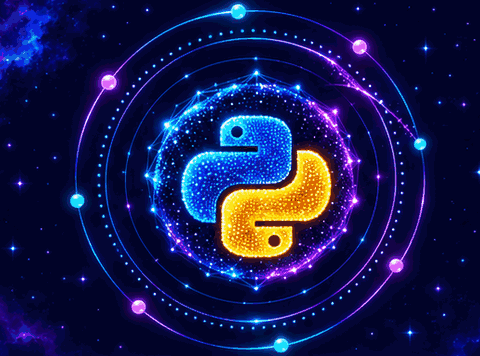
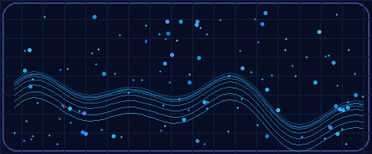
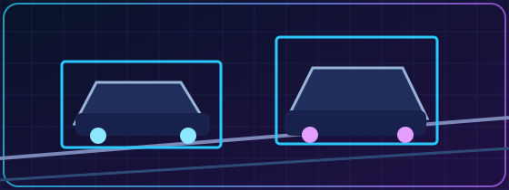
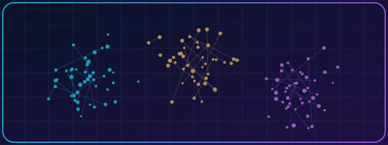
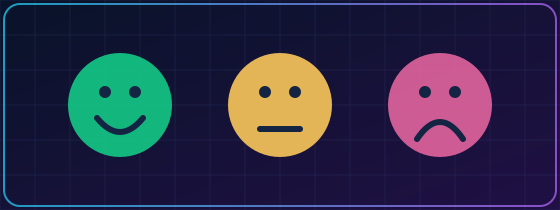
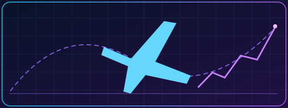

### ✦ CELESTIAL NEURAL REALM ✦

*An Informatics student exploring intelligent systems, data, and software.*

[**About**](#about-me) · [**Projects**](#featured-projects) · [**Tech Stack**](#tech-stack) · [**Experience**](#experience) · [**Activity**](#github-activity) · [**Contact**](#contact)

<table>
<tr>
<td width="53%" valign="middle">
<h2>Hello, I'm Febriyan 👋</h2>
<h3>Muhammad Febriyan Putrahariska</h3>

<strong>Informatics Undergraduate</strong> at <strong>Universitas Esa Unggul</strong>

<strong>Data Analytics · Machine Learning · AI · Mobile Development</strong>

📍 Jakarta, Indonesia · 🎓 Semester 7 (2026)

</td>
<td width="47%" align="center" valign="middle">

NEURAL CORE · Continuous particle-to-logo morphing

</td>
</tr>
</table>

## About Me

I am **Muhammad Febriyan Putrahariska**, an Informatics undergraduate interested in translating data into clear insights and building practical, measurable software. My work spans **customer segmentation, computer vision, natural language processing, analytics, and mobile development**.

<table>
<tr>
<td width="50%" valign="top">

<strong>🎯 Focus</strong>

Data Analytics · Machine Learning · Applied AI · Mobile Development

<strong>📚 Currently exploring</strong>

Indonesian NLP · Semantic similarity · Flutter · Kubernetes

</td>
<td width="50%" valign="top">

<strong>🧰 Daily toolkit</strong>

Python · SQL · Git · PostgreSQL · Tableau

<strong>🧭 My approach</strong>

Understand → Build → Validate → Improve

</td>
</tr>
</table>

## Featured Projects

Selected academic and practical work. Reported metrics describe project evaluation, not production performance.

<table>
<tr>
<td width="50%" valign="top">

<h3>🚗 Vehicle Detection with YOLO</h3>

Object detection for six vehicle classes. Covers dataset preparation, model training, evaluation and inference.

<strong>Reported validation:</strong> mAP@0.50 <strong>98.34%</strong> · mAP@0.50:0.95 <strong>91.57%</strong>

<code>Python</code> <code>PyTorch</code> <code>Ultralytics</code> <code>Computer Vision</code>

<a href="https://github.com/Febriyan2005/YOLO26-Vehicle-Object-Detection"><strong>Repository / Technical Details</strong></a>

</td>
<td width="50%" valign="top">

<h3>📊 RFM Customer Segmentation</h3>

Combined <strong>Recency, Frequency, Monetary</strong> analysis with K-Means to identify customer groups and interpret their behavior.

<strong>Reported outcome:</strong> 3 customer segments.

<code>Python</code> <code>Pandas</code> <code>Scikit-learn</code> <code>K-Means</code>

Case study · Public repository URL not confirmed.

</td>
</tr>
<tr>
<td width="50%" valign="top">

<h3>💬 Indonesian News Sentiment</h3>

Analyzed sentiment in <strong>59 Indonesian-language news articles</strong>, including data collection, preprocessing and classification.

<code>Python</code> <code>Web Scraping</code> <code>NLP</code>

Case study · Public repository URL not confirmed.

</td>
<td width="50%" valign="top">

<h3>✈️ Flight Delay Analytics</h3>

Explored flight-delay patterns by airline, geography and factors in a Tableau-based analysis.

<strong>Dataset period:</strong> 2017–2022.

<code>Tableau</code> <code>Excel</code> <code>Data Analytics</code>

Case study · Public repository URL not confirmed.

</td>
</tr>
</table>

## Tech Stack

| Area | Technologies |
|:--|:--|
| **Data and Analytics** | Python · SQL · Pandas · NumPy · Tableau · Excel |
| **Machine Learning / AI** | Scikit-learn · PyTorch · YOLO · K-Means · Model Evaluation |
| **Development** | Flutter · Dart · Git · GitHub · PostgreSQL |
| **Infrastructure (Learning)** | Docker · Kubernetes · Linux · WSL |

<b>🌌 Explore my technical realm</b>

I enjoy building reproducible data pipelines, comparing models, communicating model-performance limitations, and turning analyses into working applications. Current learning interests include semantic alignment between Indonesian news headlines and article bodies, Flutter applications, and distributed systems.

## Experience

| Period | Organization | Work |
|:--|:--|:--|
| **Jun–Aug 2026** | Ministry of Finance of the Republic of Indonesia | IT Services & Technology Management internship |
| **Feb–May 2026** | Financial Services Authority (OJK) | Capital-market regulation and development internship |
| **Feb 2022** | Zyrex Indonesia | IT support and hardware-maintenance internship |

<b>🎓 Education and community</b>

**Universitas Esa Unggul** · B.Sc. Informatics (2023–present)

Community involvement: HIMASTIKA and Google Developer Groups on Campus.

## GitHub Activity

Activity graphic is provided by the existing repository workflow. The actual GitHub contributions chart remains on the profile.

## Contact

I'm interested in collaborative projects and conversations about **analytics, applied AI, computer vision, and software development**.

[**GitHub**](https://github.com/Febriyan2005) · [**LinkedIn**](https://www.linkedin.com/in/muhammad-febriyan-putrahariska-140569307/) · [**Email**](mailto:febriyanputra2005@gmail.com)

Curiosity → Research → Build → Validate → Improve

