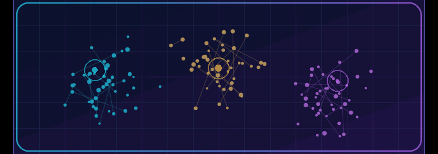
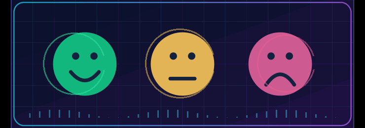
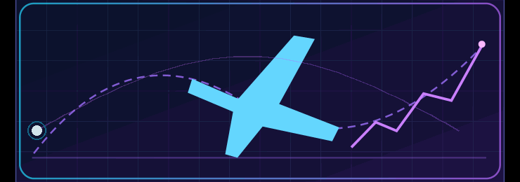

### ✦ CELESTIAL NEURAL REALM ✦

Data-driven curiosity, practical AI, and thoughtful software.

[**About**](#about-me) · [**Featured Projects**](#featured-projects) · [**Tech Stack**](#tech-stack) · [**Experience**](#experience) · [**GitHub Activity**](#github-activity) · [**Contact**](#contact)

## 👋 Hello, I'm Febriyan

# Muhammad Febriyan Putrahariska

**Informatics Undergraduate** · **Universitas Esa Unggul**  
**Data Analytics** · **Machine Learning** · **Artificial Intelligence** · **Mobile Development**  
📍 Jakarta, Indonesia &nbsp;·&nbsp; 🎓 Semester 7 (2026)

<table>
<tr>
<td width="56%" valign="top">

<h3>👨‍💻 About Me</h3>

I transform raw data into useful insights and build practical software—from customer segmentation and computer vision to Indonesian-language NLP and mobile apps.

My approach is simple: <strong>understand the problem → build → validate → improve</strong>. I value reliable experiments, clear results, and technology that solves real problems.

<strong>Exploring now</strong> Semantic alignment in Indonesian news · Flutter · Kubernetes

  

</td>
<td width="44%" valign="middle" align="center">

NEURAL CORE · An evolving technology constellation

</td>
</tr>
</table>

## 🚀 Featured Projects

Selected academic and practical projects. Metrics refer to reported evaluations—not production guarantees.

<table>
<tr>
<td width="50%" valign="top">

<h3>🚘 Vehicle Detection with YOLO</h3>

Designed a multi-class vehicle detection pipeline covering data preparation, model training, evaluation, and inference.

<strong>Reported mAP@0.50: 98.34%</strong> <strong>Reported mAP@0.50:0.95: 91.57%</strong>

<code>Python</code> <code>PyTorch</code> <code>Ultralytics</code> <code>YOLO</code>

<a href="https://github.com/Febriyan2005/YOLO26-Vehicle-Object-Detection">View Repository →</a>

</td>
<td width="50%" valign="top">

<h3>📊 RFM Customer Segmentation</h3>

Combined <strong>Recency, Frequency, and Monetary</strong> analysis with K-Means to identify patterns in customer behavior.

<strong>Outcome: 3 customer segments</strong>

<code>Python</code> <code>Pandas</code> <code>Scikit-learn</code> <code>K-Means</code>

<a href="https://github.com/Febriyan2005/RFM-Customer-Segmentation-KMeans">View Repository →</a>

</td>
</tr>
<tr>
<td width="50%" valign="top">

<h3>💬 Indonesian News Sentiment Analysis</h3>

Collected, prepared, and analyzed sentiment from <strong>59 Indonesian-language news articles</strong>.

<strong>Focus: Indonesian NLP workflows</strong>

<code>Python</code> <code>Text Processing</code> <code>Web Scraping</code> <code>NLP</code>

<a href="https://github.com/Febriyan2005/Indonesian-News-Sentiment-Analysis">View Repository →</a>

</td>
<td width="50%" valign="top">

<h3>✈️ US Flight Delay Analytics</h3>

Explored airline delay patterns by route, geography, and operational factors, visualized through Tableau.

<strong>Dataset period: 2017–2022</strong>

<code>Tableau</code> <code>Excel</code> <code>Data Analytics</code>

<a href="https://github.com/Febriyan2005/us-flight-delay-analysis-tableau">View Repository →</a>

</td>
</tr>
</table>

## 🧰 Tech Stack

<table>
<tr><td width="30%"><strong>Programming</strong></td><td><code>Python</code> <code>SQL</code> <code>Dart</code></td></tr>
<tr><td><strong>Analytics &amp; Visualization</strong></td><td><code>Pandas</code> <code>NumPy</code> <code>Tableau</code> <code>Excel</code></td></tr>
<tr><td><strong>Machine Learning</strong></td><td><code>Scikit-learn</code> <code>PyTorch</code> <code>YOLO</code> <code>NLP</code></td></tr>
<tr><td><strong>Mobile &amp; Databases</strong></td><td><code>Flutter</code> <code>PostgreSQL</code></td></tr>
<tr><td><strong>Dev &amp; Infrastructure</strong></td><td><code>Git</code> <code>GitHub</code> <code>Docker</code> <code>Kubernetes (learning)</code></td></tr>
</table>

<b>🔭 What's currently in my learning orbit?</b>

My current interests include comparing IndoBERT and multilingual BERT for Indonesian headline–article semantic alignment, improving model evaluation practices, developing Flutter applications, and learning Kubernetes and distributed systems.

## 🌠 Experience

<table>
<tr><th>Period</th><th>Organization</th><th>Area</th></tr>
<tr><td>Jun–Aug 2026</td><td>Ministry of Finance of the Republic of Indonesia</td><td>IT services and technology management (internship)</td></tr>
<tr><td>Feb–May 2026</td><td>Financial Services Authority (OJK)</td><td>Capital-market regulation and development (internship)</td></tr>
<tr><td>Feb 2022</td><td>Zyrex Indonesia</td><td>IT support and hardware maintenance (internship)</td></tr>
</table>

<b>🎓 Education and community</b>

**Universitas Esa Unggul** · B.Sc. Informatics (in progress)  
Community interests: HIMASTIKA and Google Developer Groups on Campus.

## 📈 GitHub Activity

Contribution animation is produced by the existing repository workflow; actual activity is visible on the GitHub profile.

## ✉️ Contact

Interested in analytics, practical AI, computer vision, or building software together? Let's connect.

[**GitHub**](https://github.com/Febriyan2005) · [**LinkedIn**](https://www.linkedin.com/in/muhammad-febriyan-putrahariska-140569307/) · [**Email**](mailto:febriyanputra2005@gmail.com)

Understand → Build → Validate → Improve

