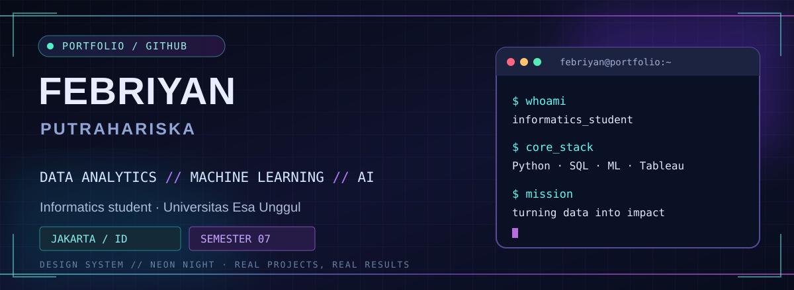
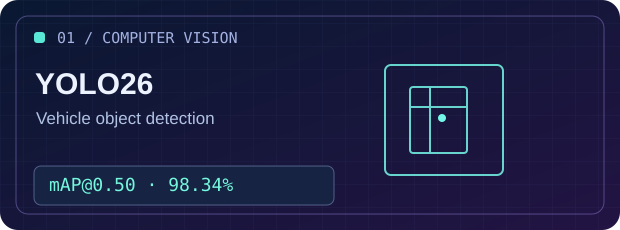
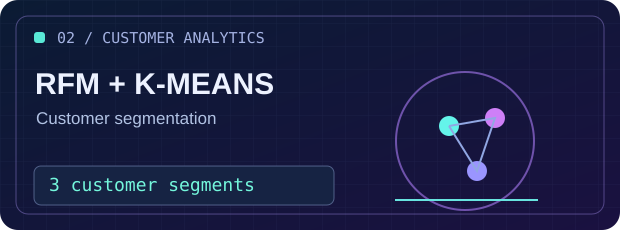
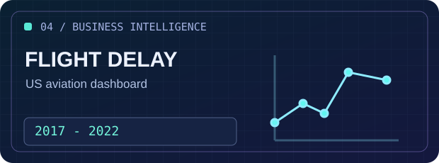

<div align="center">



<br />

**Informatics Student · Data Analytics · Machine Learning · Artificial Intelligence**

<a href="https://github.com/Febriyan2005">GitHub</a> ·
<a href="https://www.linkedin.com/in/muhammad-febriyan-putrahariska-140569307/">LinkedIn</a> ·
<a href="mailto:febriyanputra2005@gmail.com">Email</a>

<sub>Jakarta, Indonesia · Universitas Esa Unggul · Semester 7</sub>

</div>

---

### `> whoami`

I'm **Muhammad Febriyan Putrahariska**, a seventh-semester **Informatics undergraduate at Universitas Esa Unggul**, Indonesia.

I enjoy transforming raw data into meaningful insights, developing machine learning solutions, and making complex findings easier to understand. My work spans **data analytics, customer segmentation, computer vision, natural language processing, and business intelligence**.

I've gained internship experience with the **Ministry of Finance of the Republic of Indonesia**, **Indonesia Financial Services Authority (OJK)**, and **Zyrex Indonesia**.

```text
$ febriyan --about
  education  : B.Sc. Informatics (in progress, Semester 7)
  university : Universitas Esa Unggul, Jakarta
  interests  : Data Analytics | Machine Learning | Computer Vision | NLP
  languages  : Python | SQL | Java (foundational) | HTML/CSS
  mindset    : Learn → Build → Validate → Improve
```

### `> core_stack`

| Domain | Technologies and tools |
|:--|:--|
| **Data & Analytics** | Python · Pandas · NumPy · SQL · Excel / Pivot Tables · Tableau |
| **Machine Learning** | Scikit-learn · K-Means · RFM · Model Evaluation |
| **AI / Computer Vision** | PyTorch · YOLO26 · Object Detection · Google Colab |
| **NLP** | Web Scraping · Text Preprocessing · Lexicon-Based Sentiment Analysis |
| **Development** | Java (foundational) · HTML/CSS · Git · GitHub |

### `> selected_work`

<table>
<tr>
<td width="50%" valign="top">



<strong>01. Vehicle Detection · YOLO26</strong>

Fine-tuned a YOLO26 Nano model to detect <strong>six vehicle classes</strong>, with dataset auditing, training and model evaluation.

<strong>Validation results:</strong> <code>mAP@0.50: 98.34%</code> · <code>mAP@0.50:0.95: 91.57%</code>

<strong>Stack:</strong> Python · PyTorch · Ultralytics · Google Colab

<a href="https://github.com/Febriyan2005/YOLO26-Vehicle-Object-Detection"><strong>Explore repository →</strong></a>

</td>
<td width="50%" valign="top">



<strong>02. Customer Segmentation · RFM + K-Means</strong>

Designed a customer segmentation pipeline using <strong>Recency, Frequency, Monetary (RFM)</strong> analysis, feature transformations, standardization and clustering validation.

<strong>Outcome:</strong> <code>3 customer segments</code> for marketing recommendations.

<strong>Stack:</strong> Python · Pandas · Scikit-learn

<sub>Portfolio case study · Public repository link not yet provided</sub>

</td>
</tr>
<tr>
<td width="50%" valign="top">


<strong>03. Indonesian Health News · Sentiment Analysis</strong>

Built a scraping and preprocessing workflow for Indonesian health news, followed by <strong>lexicon-based sentiment analysis</strong> on 59 unique articles.

<strong>Result:</strong> <code>54.24% negative</code> · <code>45.76% positive</code>

<strong>Stack:</strong> Python · Web Scraping · NLP

<sub>Portfolio case study · Public repository link not yet provided</sub>

</td>
<td width="50%" valign="top">



<strong>04. US Flight Delay Analytics · Tableau</strong>

Analyzed US flight delays (2017–2022) and developed a dashboard exploring <strong>airline performance, geographical distribution, and delay causes</strong>.

<strong>Coverage:</strong> <code>2017–2022</code> aviation data.

<strong>Stack:</strong> Tableau · Excel · Data Cleaning

<sub>Portfolio case study · Public repository link not yet provided</sub>

</td>
</tr>
</table>

### `> experience`

| Period | Organization / Role | Selected contributions |
|:--|:--|:--|
| **Jun–Aug 2026** | **Ministry of Finance of the Republic of Indonesia** — IT Services & Technology Management Intern, KPPN Khusus Penerimaan (DJPb) | Data cleansing, SQL and Excel analysis, reconciliation, documentation, and user requirements support |
| **Feb–May 2026** | **Indonesia Financial Services Authority (OJK)** — Capital Market Regulation & Development Intern | Regulatory data analysis, policy research, documentation, and internal presentations |
| **Feb 2022** | **Zyrex Indonesia** — IT Support & Hardware Maintenance Intern | PC assembly, laptop configuration, maintenance, and daily technical support |

### `> education_and_learning`

**Universitas Esa Unggul** — B.Sc. in Informatics / Teknik Informatika  
`2023 – Present` · Currently in **Semester 7** · Jakarta, Indonesia

**Selected certifications**
- Developing Generative AI Applications on Microsoft Azure — Dicoding × Microsoft Elevate Training Center (2025)
- Cyber Security Dasar — ID-Networkers (2026)
- QA Test Technique — MySkill (2026)

**Community experience:** HIMASTIKA, Innovation & Achievement Division (2024–2025) · Google Developer Group on Campus, Universitas Esa Unggul (2023–2024)

### `> contributions`

<div align="center">

<!-- Contribution art generated by the existing workflow in this repository. -->


<sub>For detailed contribution activity, see the native GitHub contribution calendar below this README.</sub>

</div>

### `> connect`

<div align="center">

**Open to learning, collaboration, and conversations about data and technology.**

[GitHub](https://github.com/Febriyan2005) ·
[LinkedIn](https://www.linkedin.com/in/muhammad-febriyan-putrahariska-140569307/) ·
[Email](mailto:febriyanputra2005@gmail.com)

<sub>Made with curiosity, code, and a commitment to continuous learning.</sub>

</div>
